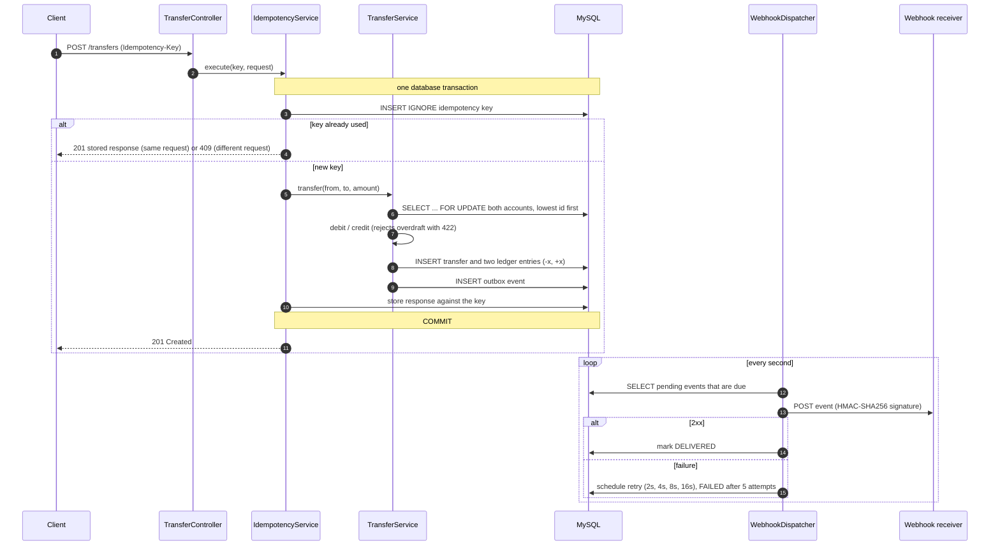
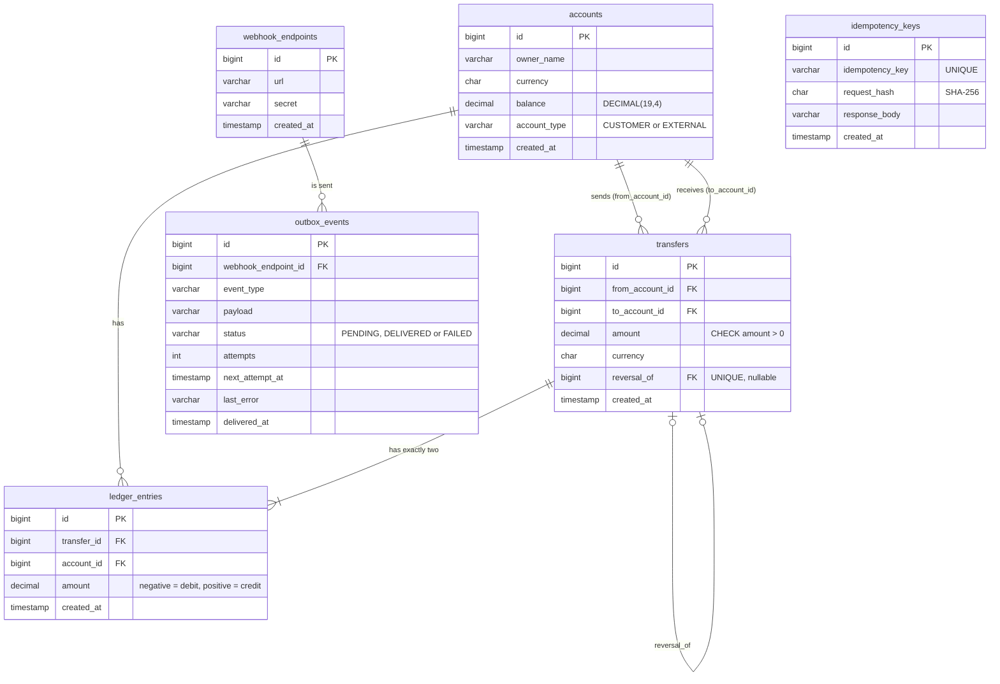

# Payments Ledger

A double-entry payments ledger API: accounts, transfers, deposits and reversals, built so that money is never duplicated, lost or overdrawn under concurrent load.

[](https://github.com/aaryanahmed-dev/PaymentsLedger/actions/workflows/ci.yml)


**Live demo (Swagger UI):** https://payments-ledger-5x7m.onrender.com/swagger-ui.html

The demo runs on free hosting (Render, with a small hosted MySQL). It sleeps when idle, so the first request can take about a minute, and it is slower than a local run.

## Overview

Payments Ledger is the core of a payments backend, reduced to the parts that are hard to get right. It records who holds how much money, moves money between accounts, and keeps an immutable history of every movement.

It is the kind of service a marketplace, wallet or fintech product sits on top of: other services call it to move money and are notified by webhook when a transfer happens.

The problem it solves is correctness. Moving money looks like two `UPDATE` statements, but real systems have to survive simultaneous requests on the same account, clients that retry after a timeout, crashes halfway through an operation, and downstream systems that are unavailable. Each of those is handled explicitly here, and each has tests.

## Key guarantees

| Guarantee | How it is enforced | Where it is tested |
|---|---|---|
| **No double charges** | `POST /transfers` and deposits require an `Idempotency-Key`. A repeated request returns the original response without moving money. A unique constraint makes this hold for simultaneous duplicates. | `IdempotencyTest`: 20 concurrent copies of one request produce one transfer |
| **No overdrafts** | The rule lives in `Account.debit()`. Account rows are locked (`SELECT ... FOR UPDATE`) before balances are read, so two transfers cannot both spend the same money. | `TransferConcurrencyTest`: 100 concurrent withdrawals of 10.00 from 100.00, exactly 10 succeed |
| **Money is never created or lost** | Every transfer writes two ledger entries, `-x` and `+x`, in the same transaction as both balance updates. All entries always sum to zero. | Ledger invariants asserted after every transfer test, and by reconciliation after the load test |
| **Full audit trail** | Transfers and ledger entries are never updated or deleted. A reversal is a new, linked transfer in the opposite direction. | `TransferReversalTest` |

## Architecture

Requests go through a conventional layered Spring Boot application (controller, service, repository) backed by one MySQL database. There is no cache and no message broker: MySQL provides the locking, the idempotency constraint and the webhook outbox.

### Transfer flow



### Data model



## API reference

Interactive documentation is served at `/swagger-ui.html`, and the OpenAPI document at `/v3/api-docs`.

| Method | Path | Description |
|---|---|---|
| `POST` | `/accounts` | Create a customer account with a zero balance |
| `GET` | `/accounts` | List accounts |
| `GET` | `/accounts/{id}` | Get one account and its balance |
| `GET` | `/accounts/{id}/entries?page=0&size=20` | Ledger entries of an account, newest first (`size` 1 to 100) |
| `POST` | `/accounts/{id}/deposits` | Deposit money. Requires `Idempotency-Key`. Supported currencies: EUR, USD, GBP |
| `POST` | `/transfers` | Move money between two accounts of the same currency. Requires `Idempotency-Key` |
| `GET` | `/transfers/{id}` | Get one transfer |
| `POST` | `/transfers/{id}/reverse` | Reverse a transfer (at most once) |
| `POST` | `/webhook-endpoints` | Register a webhook URL. The signing secret is returned once |
| `GET` | `/webhook-endpoints` | List webhook endpoints (without secrets) |
| `GET` | `/admin/reconciliation` | Verify the ledger invariants and report mismatches |
| `GET` | `/actuator/health` | Health check |

Errors are returned as [RFC 9457](https://www.rfc-editor.org/rfc/rfc9457) problem details.

| Status | Meaning |
|---|---|
| `400` | Invalid input: missing or malformed field, non-positive amount, more than 2 decimal places, same account twice, missing `Idempotency-Key` |
| `404` | Account or transfer not found |
| `409` | `Idempotency-Key` reused for a different request; transfer already reversed, or is itself a reversal |
| `422` | Business rule refused the request: insufficient funds, currency mismatch, deposit in an unsupported currency |

### Examples

The responses below are real output from the application running under `docker compose`.

Create an account:

```bash
curl -X POST http://localhost:8080/accounts \
  -H "Content-Type: application/json" \
  -d '{"ownerName": "Alice Martin", "currency": "EUR"}'
```

```json
{"id":4,"ownerName":"Alice Martin","currency":"EUR","balance":0,"createdAt":"2026-11-15T21:31:41.827561480Z","accountType":"CUSTOMER"}
```

Deposit (a transfer from the external funding account, id 1):

```bash
curl -X POST http://localhost:8080/accounts/4/deposits \
  -H "Content-Type: application/json" \
  -H "Idempotency-Key: dep-001" \
  -d '{"amount": 100.00}'
```

```json
{"id":1,"fromAccountId":1,"toAccountId":4,"amount":100.00,"currency":"EUR","createdAt":"2026-11-15T21:31:42.097018084Z","reversalOf":null}
```

Transfer:

```bash
curl -X POST http://localhost:8080/transfers \
  -H "Content-Type: application/json" \
  -H "Idempotency-Key: tr-001" \
  -d '{"fromAccountId": 4, "toAccountId": 5, "amount": 25.00}'
```

```json
{"id":2,"fromAccountId":4,"toAccountId":5,"amount":25.00,"currency":"EUR","createdAt":"2026-11-15T21:31:42.295181587Z","reversalOf":null}
```

Sending exactly the same request again returns the same body (same `id`, same `createdAt`) and moves no money. Reusing the key with a different amount:

```json
{"detail":"This Idempotency-Key was already used for a different request","instance":"/transfers","status":409,"title":"Conflict"}
```

Insufficient funds:

```json
{"detail":"Account with id 5 has insufficient funds","instance":"/transfers","status":422,"title":"Unprocessable Content"}
```

Invalid input:

```json
{"detail":"Invalid request content.","instance":"/transfers","status":400,"title":"Bad Request","errors":{"toAccountId":"must not be null","amount":"must be greater than 0"}}
```

Reverse a transfer:

```bash
curl -X POST http://localhost:8080/transfers/2/reverse
```

```json
{"id":3,"fromAccountId":5,"toAccountId":4,"amount":25.0000,"currency":"EUR","createdAt":"2026-11-15T21:31:43.009975197Z","reversalOf":2}
```

Account history:

```bash
curl "http://localhost:8080/accounts/4/entries?size=5"
```

```json
{"content":[{"id":3,"transferId":2,"accountId":4,"amount":-25.0000,"createdAt":"2026-11-15T21:31:42Z"},{"id":2,"transferId":1,"accountId":4,"amount":100.0000,"createdAt":"2026-11-15T21:31:42Z"}],"page":0,"size":5,"totalElements":2,"totalPages":1}
```

Reconciliation:

```bash
curl http://localhost:8080/admin/reconciliation
```

```json
{"checkedAt":"2026-11-15T21:31:43.261001701Z","balanced":true,"ledgerTotal":0.0000,"accountsChecked":5,"entriesChecked":6,"mismatches":[]}
```

### Webhooks

Register a URL with `POST /webhook-endpoints` (`{"url": "https://example.com/hooks"}`). Each transfer then produces a `transfer.created` event, and each reversal a `transfer.reversed` event:

```
POST /hooks
Content-Type: application/json
X-Webhook-Event-Id: 42
X-Webhook-Signature: t=1700000000,v1=<hex HMAC-SHA256>

{"type":"transfer.created","data":{"id":2,"fromAccountId":4,"toAccountId":5,"amount":25.00,"currency":"EUR","createdAt":"...","reversalOf":null}}
```

To verify a request, compute `HMAC-SHA256(secret, t + "." + rawBody)` and compare it with `v1`. Delivery is at-least-once, so receivers should ignore an `X-Webhook-Event-Id` they have already processed.

## Design decisions

**Double-entry ledger.** Every transfer is stored as two entries that sum to zero, and the account balance is a cached total of that account's entries. This gives two invariants that can be checked at any time, and an immutable history. The trade-off is more writes per transfer (five rows touched) and a balance column that must be kept in step with the entries; reconciliation exists to detect if it ever is not.

**Pessimistic locking with lock ordering.** A transfer locks both account rows with `SELECT ... FOR UPDATE` before reading balances, always in ascending id order so that A→B and B→A cannot deadlock. Optimistic locking (`@Version`) would avoid blocking but turns contention into failed requests that must be retried, and hot accounts are normal in payments. The trade-off is throughput: transfers on the same account run one at a time. Locks are held by the database, so this is correct with any number of application instances.

**Idempotency keys.** The client supplies a key per intended operation. The key, a SHA-256 hash of the request and the response are stored in the same transaction as the transfer; a unique constraint serialises simultaneous duplicates. Trade-offs: only successful responses are stored (a failed request rolls back its key and can be retried with it), keys are never expired, and the `INSERT IGNORE` used to claim a key is MySQL-specific.

**Outbox pattern for webhooks.** A database commit and an HTTP call cannot be made atomic, so the event is written to an `outbox_events` table in the transfer's transaction and delivered afterwards by a scheduled job with exponential backoff. An event exists if and only if its transfer committed. Trade-offs: delivery is at-least-once rather than exactly-once, events arrive up to a second after the transfer, and the dispatcher assumes a single instance (two instances could send the same event twice).

**`BigDecimal` for money.** Binary floating point cannot represent most decimal fractions, so `double` accumulates rounding errors. Amounts are `BigDecimal` in Java and `DECIMAL(19,4)` in MySQL, the API accepts at most 2 decimal places, and comparisons use `compareTo` so that `1.0` and `1.00` are equal. The trade-off is more verbose arithmetic.

**Flyway migrations.** The schema is defined by versioned SQL files that are never edited after being applied, and Hibernate runs with `ddl-auto=validate` so the application refuses to start if entities and schema disagree. The trade-off against letting Hibernate generate the schema is writing SQL by hand; in return every environment, including the test containers, has exactly the same schema and its history.

**Auto-increment IDs.** Simple, compact and index-friendly, and insertion order is useful for a ledger. The trade-off is that they are guessable and reveal volume, which matters once the API is public. Exposing separate public UUIDv7 identifiers is listed under future improvements.

**No Redis or Kafka.** Row locks, a unique constraint and an outbox table in MySQL cover locking, idempotency and reliable event delivery, and they share the transfer's transaction, which an external cache or broker could not. Fewer moving parts also means fewer failure modes to reason about. The trade-off is scale: the database is the bottleneck, and a distributed lock or a broker would be needed well before this design reached very high volumes.

## Testing and results

### Test strategy

100 automated tests, run with `./mvnw verify`:

- **Unit tests** (JUnit 5, no Spring) for the domain rules: debit and credit, the overdraft rule, webhook retry backoff, HMAC signing (checked against a value computed independently in Python).
- **Integration tests** (MockMvc) for every endpoint, including each error case, against a real MySQL 8.4 started by Testcontainers. No in-memory database or repository mocks are used, because the behaviour under test (transactions, constraints, row locks) is the database's.
- **Concurrency tests** (`ExecutorService` + `CountDownLatch`): 100 concurrent withdrawals from one account, opposite-direction transfers between two accounts, concurrent deposits, 20 concurrent duplicate requests with one idempotency key, and 10 concurrent reversals of one transfer. The withdrawal, opposite-direction and deposit tests were written before the locking and failed without it.
- **Webhook tests** against MockWebServer: delivery, retry after failure, permanent failure after 5 attempts, unreachable endpoint, and signature verification.
- **Ledger invariants**: a shared helper asserts, in plain SQL, that all entries sum to zero and every balance equals the sum of its entries. It runs after every transfer, idempotency and reversal test.

### Load test

A [k6](https://k6.io) script (`loadtest/transfers.js`) creates 20 accounts, runs 5,000 random transfers from 50 concurrent virtual users, then calls the reconciliation endpoint. The run fails unless the ledger balances.

Measured on 2026-11-15:

| | |
|---|---|
| Virtual users | 50 |
| Transfer requests | 5,000 |
| Transfers created (`201`) | 4,565 |
| Rejected for insufficient funds (`422`) | 435 |
| Failed or unexpected responses | 0 (0.00%) |
| Total run time | 38.5 s |
| Throughput | 129.9 transfer requests/s |
| Request duration | avg 366 ms, median 360 ms, p95 487 ms, max 764 ms |
| Reconciliation afterwards | `balanced: true`, ledger total 0, 0 mismatched accounts, 9,310 entries checked |
| Negative balances | none |

These figures are from a single developer machine (Intel Core i5-8400, 32 GB RAM; application on the host, MySQL 8.4 in Docker Desktop, default connection pool of 10) and are not a capacity claim. Only 20 accounts are used so that almost every transfer contends for a row lock. The setup, commands and raw k6 output are in [`loadtest/`](loadtest/README.md).

## Running locally

### Prerequisites

- Docker (Docker Desktop on Windows or macOS)
- To run the tests or the application outside Docker: JDK 17 or newer. Maven is not required; the Maven wrapper is included.

### Start everything

```bash
docker compose up --build
```

- API: http://localhost:8080
- Swagger UI: http://localhost:8080/swagger-ui.html

The database schema is created by Flyway on startup. Stop with `docker compose down` (add `-v` to delete the data).

### Environment variables

| Variable | Default | Description |
|---|---|---|
| `DB_URL` | `jdbc:mysql://localhost:3306/payments_ledger` | JDBC URL of the MySQL database |
| `DB_USER` | `ledger_app` | Database user |
| `DB_PASSWORD` | empty (`local-dev-only` in Docker Compose) | Database password |
| `PORT` | `8080` | HTTP port |
| `DB_POOL_SIZE` | `10` | Maximum number of database connections |
| `CORS_ALLOWED_ORIGINS` | `http://localhost:5173` | Comma-separated browser origins allowed to call the API |

For Docker Compose, copy `.env.example` to `.env` to override the defaults. `.env` is ignored by git.

### Run the tests

```bash
cd backend
./mvnw verify        # Windows: mvnw.cmd verify
```

Docker must be running: the integration tests start their own MySQL container. No local database or environment variables are needed.

### Run the load test

```bash
docker compose up --build -d
docker run --rm -v "${PWD}/loadtest:/scripts" \
  -e BASE_URL=http://host.docker.internal:8080 \
  grafana/k6 run /scripts/transfers.js
```

## Project structure

```
.
├── backend/
│   ├── Dockerfile
│   ├── pom.xml
│   └── src/
│       ├── main/java/com/aaryanahmed/paymentsledger/
│       │   ├── account/          Account entity (debit/credit rules), accounts API
│       │   ├── transfer/         Transfers, deposits, reversals
│       │   ├── ledger/           Ledger entries and account history
│       │   ├── idempotency/      Idempotency-Key handling
│       │   ├── webhook/          Webhook endpoints, outbox, dispatcher, signing
│       │   ├── reconciliation/   Invariant checks: endpoint and scheduled job
│       │   └── common/           Error handling, CORS, OpenAPI, scheduling config
│       ├── main/resources/
│       │   ├── application.properties
│       │   └── db/migration/     Flyway migrations V1 to V8
│       └── test/                 Unit, integration, concurrency and webhook tests
├── loadtest/                     k6 script, instructions and recorded results
├── docs/LEARNING_NOTES.md        Notes on the concepts behind each part
├── .github/workflows/ci.yml      Build and test on every push and pull request
└── docker-compose.yml            MySQL and the application
```

## Limitations

This is a portfolio project, not a production system. In particular:

- There is no authentication or authorisation. Every endpoint, including `/admin/reconciliation` and webhook registration, is open.
- Transfers are single-currency. Deposits are supported for EUR, USD and GBP only.
- Webhook secrets are stored in plain text, endpoints cannot be deleted, and URLs are not checked against internal addresses.
- Idempotency keys are kept indefinitely.

## Future improvements

- Authentication and per-client authorisation (API keys or OAuth 2), with the admin endpoint restricted
- Public UUIDv7 identifiers in place of exposed auto-increment ids
- Multi-currency transfers with FX rates
- Publishing outbox events to Kafka instead of, or as well as, HTTP webhooks
- Rate limiting
- Expiry of idempotency keys, and multi-instance webhook dispatch using `SELECT ... FOR UPDATE SKIP LOCKED`

## Author

**Aaryan Ahmed**

- GitHub: [github.com/aaryanahmed-dev](https://github.com/aaryanahmed-dev)
- LinkedIn: [linkedin.com/in/aaryan-ahmed](https://linkedin.com/in/aaryan-ahmed)
